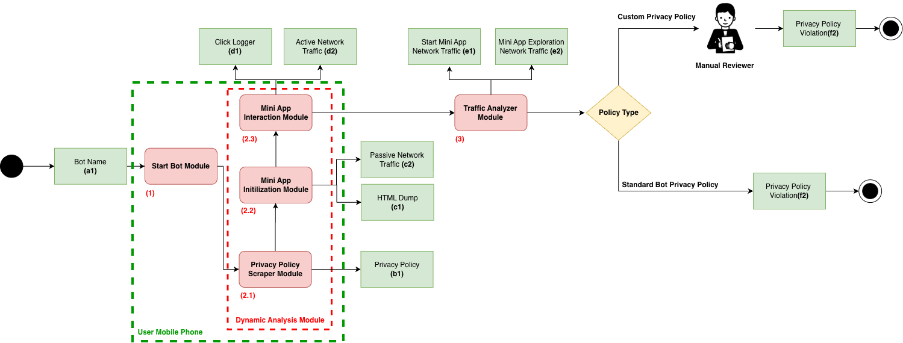

# TeleGapper

[](https://arxiv.org/abs/2608.13390)

## Citation

If you use TeleGapper in your research, please cite our paper:

```bibtex
@misc{ferrari2026telegapperunreliabilityprivacypolicies,
      title={TeleGapper: On the (un)reliability of Privacy Policies in Telegram Mini apps}, 
      author={Luca Ferrari and Mariano Ceccato and Luca Verderame},
      year={2026},
      eprint={2608.13390},
      archivePrefix={arXiv},
      primaryClass={cs.CR},
      url={https://arxiv.org/abs/2608.13390}, 
}
```

**TeleGapper** is a black-box dynamic analysis tool for Telegram Mini Apps on Android devices.

It drives Telegram with Appium, opens a target bot, starts the Mini App, saves HTML, copies proxy traffic, and builds JSON reports with extracted sensitive-data indicators.

## Methodology



Given a bot name **(a1)**, the *Start Bot Module* **(1)** opens the chat on the user's
Android device. The *Dynamic Analysis Module* **(2)** then runs three stages on the
device: the *Privacy Policy Scraper* **(2.1)** collects the declared policy **(b1)**,
the *Mini App Initialization Module* **(2.2)** launches the Mini App and captures the
HTML dump **(c1)** and passive network traffic **(c2)**, and the *Mini App Interaction
Module* **(2.3)** drives the UI while recording the click log **(d1)** and the active
network traffic **(d2)**.

The *Traffic Analyzer Module* **(3)** splits the captured traffic into start-up **(e1)**
and exploration **(e2)** phases and matches the observed data flows against the policy.
Apps with a standard bot privacy policy are flagged automatically **(f2)**; apps with a
custom policy go to a manual reviewer before the violation verdict is issued.

## Features

- Automated Telegram navigation (`@bot` search, chat open, Mini App launch)
- Native + WebView extraction flow
- HTML source dump (XML UI dump helpers are available but disabled in the current flow)
- Per-bot traffic copy from Burp log
- Traffic analysis report (`scripts/TrafficAnalysis.py`)
- Privacy keyword checks on HTML and on XML when an XML dump is available

## Repository Layout

- `Automator.py`: main entry point
- `ScraperMiniApp/scraper.py`: Selenium scraper for `https://tapps.center/`
- `ScraperMiniApp/README.md`: scraper usage, configuration and limitations
- `ScraperMiniApp/D_ExcludedHost.txt`: existing list of bot usernames
- `tapps_apps_live_June.csv`: bundled June catalog snapshot
- `scripts/DynamicAnalysis.py`: Appium flow + extraction pipeline
- `scripts/Util.py`: filesystem, WebView/debug helpers, keyword scan
- `scripts/ProxySetUp.py`: Burp log reset/copy utilities
- `scripts/TrafficAnalysis.py`: traffic parser and report generator
- `script.sh`: batch execution over `ScraperMiniApp/rerun.txt` (create this input file before running a batch)
- `Analysis results/`: analysis output directory; includes sample privacy-policy HTML/PDF files for `@wallet`
- `Dockerfile`, `docker-compose.yml`, `docker/`: containerized pipeline

## Docker

TeleGapper can run in a container while Appium, the adb server and Burp stay on
the host (the Android device is on USB, which Docker Desktop cannot pass through).

Follow [docker/README-docker.md](docker/README-docker.md) to create the local
configuration and input files, build the images, and start the host services.
The pipeline requires a Burp log file and `ScraperMiniApp/rerun.txt` for its
bind mounts, including when running a single bot. Neither file is bundled.
The scraper service runs independently of those files and the Android device.

## Prerequisites

- Python `3.10+`
- Android device with Telegram installed and logged in (**Battery usage for Telegram MUST be set to Unrestricted** to prevent the system from aggressively killing it)
- `adb` available in PATH and USB debugging enabled
- Appium server running (default `http://127.0.0.1:4723`)
- Matching Chromedriver binaries for Telegram WebView
- Burp Suite logging to a text file, with the device configured to send traffic through it
- WeasyPrint native libraries for privacy-policy PDF export (the Docker image installs them)

## Setup

1. Create and activate a virtual environment:

```bash
python3 -m venv venv
source venv/bin/activate
```

2. Install dependencies:

```bash
pip install -r requirements.txt
```

3. Create `.env` in the repository root with the following settings, adapting
   paths and device capabilities to your machine. No `.env.example` is bundled:

```env
APPIUM_SERVER_URL="http://127.0.0.1:4723"
APPS_DIR="Analysis results"
BURP_LOG_FILE="burp_log.txt"
```

`APPS_DIR`, `BURP_LOG_FILE` and `APPIUM_LOG_FILE` are resolved relative to the
repository root unless absolute. `APPS_DIR` defaults to `Analysis results/` and
`APPIUM_LOG_FILE` to `appium_server.log`. `BURP_LOG_FILE` is required and has no
default. Configure the device proxy and Burp logging separately; the pipeline
does not configure Burp from `proxy_config.json`.

4. Add the device capabilities to `.env`:

```env
ANDROID_DEVICE_NAME="<adb devices serial>"   # empty = let Appium pick the only device
ANDROID_PLATFORM_VERSION="16"              # set to your device's Android version
CHROMEDRIVER_DIR="/absolute/path/to/chromedrivers"
CHROMEDRIVER_MAPPING_FILE="/absolute/path/to/chromedriver_mapping.json"
```

5. The pipeline creates its output directories automatically. XML dumps and
   screenshot capture are currently commented out in `scripts/DynamicAnalysis.py`.

## Burp Logging (One-Time)

Configure Burp to continuously log Proxy requests/responses to the same file used in `BURP_LOG_FILE`.

The run flow clears that file before Mini App initialization, copies the initial
traffic to `Analysis results/trafficStart/@<bot>_traffic.txt`, clears the log
before interaction, and copies interaction traffic to
`Analysis results/trafficEnd/@<bot>_traffic.txt` at the end. It clears the source
log again after analysis.

## Usage

1. Start Appium:

```bash
appium --allow-insecure uiautomator2:chromedriver_autodownload
```

2. Run a single bot:

```bash
python Automator.py @DetectivePuzzlesBot
```

3. Create `ScraperMiniApp/rerun.txt` with one bot username per line (including
   the leading `@`), then run batch mode. This file is a local input and is not
   included in the repository. For example:

```bash
cat > ScraperMiniApp/rerun.txt <<'EOF'
@wallet
@DetectivePuzzlesBot
EOF
bash ./script.sh
```

4. Run the Tapps catalog scraper:

```bash
python ScraperMiniApp/scraper.py
```

See [ScraperMiniApp/README.md](ScraperMiniApp/README.md) for browser settings,
CSV output and the scraper's historical site compatibility limitation. The
scraper produces a catalog CSV; it does not create the batch input file.

## Output

- `Analysis results/html/<slug>_mini_app.html`
- `Analysis results/trafficStart/@<bot>_traffic.txt` (initial traffic)
- `Analysis results/trafficEnd/@<bot>_traffic.txt` (interaction traffic)
- `Analysis results/resStart/<bot>_report.json` (initial traffic findings and privacy keyword checks; report name without `@`)
- `Analysis results/resEnd/<bot>_report.json` (interaction traffic findings; report name without `@`)
- `Analysis results/dynamicAnalysis/<slug>/clicks.json` (interaction log, when clicks are recorded)
- `Analysis results/PrivacyPolicies/@<bot>_privacy_policy.html` and/or `.pdf` (when policy retrieval/export succeeds)
- `tapps_apps_live.csv` (generated by `ScraperMiniApp/scraper.py` at the repository root, or at `TAPPS_CSV` if set)

`APPS_DIR` changes the analysis output root. `<slug>` is the bot username with
`@` and every lowercase `bot` substring removed, as implemented by
`Util.bot_slug()`. XML and screenshot directories are also created, but the
current flow does not capture those artifacts.

## Notes

- `Automator.py` expects one positional argument: bot username (for example `@wallet`).
- WebView debug is enabled via `adb shell setprop debug.chromium.webview_debug true`.
- The current workflow reboots the device at the end of each run (`adb reboot` in `reboot_device()`).
- The Tapps scraper uses Selenium 4 driver management by default and optionally `webdriver-manager` if installed.
- **Note on Scraper Mini App**: The scraper was functional until June 2026. The interface of the scraped site was changed in August 2026. However, the site can still be found on the snapshot from June 6, 2026, on the [Wayback Machine - Internet Archive](https://web.archive.org/web/20260606072458/https://tapps.center/).
